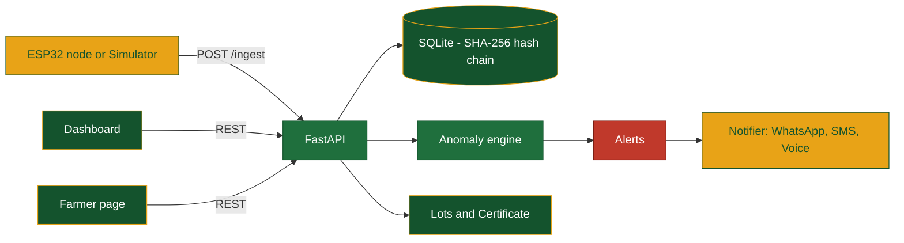
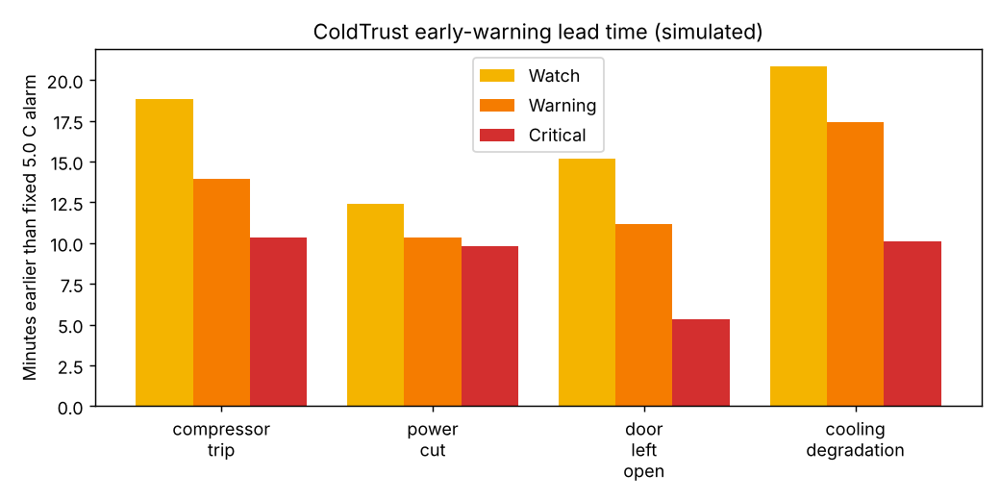

<div align="center">


<a href="https://git.io/typing-svg">
  
</a>

<br/>


### 🌾 Low-cost IoT + AI that protects every harvest in cold storage 🌾

[🚀 Quick Start](#-quick-start) · [✨ Features](#-features) · [🧠 How It Works](#-how-it-works) · [📊 Results](#-measured-results) · [👥 Roles](#-roles--access) · [🔌 Real Hardware](#-moving-to-the-real-thing) · [🤝 Team](#-team)

</div>

<br/>

---

## 💡 What is ColdTrust?

Cold-storage owners usually find out about a failing compressor **after** the crop is already damaged. ColdTrust watches every chamber, **learns its normal behaviour**, and warns **early** in **Hindi** so the owner, manager, technician and even the farmer can act in time.

> 🟢 **Watch** → 🟠 **Warning** → 🔴 **Critical** → 📞 **automatic Hindi voice-call escalation** until someone acknowledges.

Everything runs on a laptop with **no hardware and no paid accounts**. A built-in simulator plays the ESP32 sensor nodes, and WhatsApp / SMS / voice run in **MOCK mode** (shown in the dashboard instead of being sent).

<br/>

## ✨ Features

<table>
<tr>
<td width="50%" valign="top">

### 🧠 Smart Detection
- Learned **normal band** per chamber
- Rate-of-change + door / compressor context
- **IsolationForest** anomaly model
- 3 alert levels with *minutes-to-limit* estimate
- **Sensor-offline alert** (5 min → Warning, 15 min → Critical)

</td>
<td width="50%" valign="top">

### 📲 Hindi Alerts
- WhatsApp / SMS to owner and manager
- Hindi update to **every farmer** with a lot in that chamber
- **Voice-call chain** owner → manager → technician
- Voice menu: **1** = acknowledge, **2** = hear temperature
- Weekly report PDF + Hindi summary

</td>
</tr>
<tr>
<td width="50%" valign="top">

### 🔐 Trust & Proof
- **SHA-256 hash chain** over every reading
- Tamper-evident **PDF certificate + QR**
- Public `/verify/<id>` page
- One-click *tamper* / *restore* demo
- Farmer lot linked to its chamber

</td>
<td width="50%" valign="top">

### 🏭 Operations
- Multi-chamber, **multi-site** with map
- **Spoilage risk score** (0-100) per lot
- Maintenance reminders (days or run-hours)
- Compressor-current monitoring (optional CT sensor)
- Careers page, applications & suggestion box

</td>
</tr>
<tr>
<td colspan="2" valign="top">

### 📡 Edge Node
ESP32 + SHT31 sensor with **offline buffering in flash**: readings are saved while the network is down and flushed later with `POST /ingest/batch`, so graphs have no gaps.

</td>
</tr>
</table>

<br/>

## 🚀 Quick Start

```bash
# 1️⃣ install
pip install -r requirements.txt

# 2️⃣ run: website + dashboard + API on ONE link
python run_demo.py
```

| 🔗 Page | URL |
|---|---|
| 🌐 Public website | http://localhost:8000 |
| 📊 Dashboard | http://localhost:8000/dashboard |
| 📘 API docs (Swagger) | http://localhost:8000/docs |
| 💼 Careers | http://localhost:8000/careers |

<details>
<summary><b>🐳 Docker / other commands</b></summary>

```bash
docker compose up --build        # not tested in the build environment

python -m pytest                 # run the tests
python evaluate.py               # offline model evaluation
python -m src.train_model        # retrain the model
python create_demo_users.py      # one demo login per role + a demo lot
```
</details>

<details>
<summary><b>🔑 Demo logins (demo passwords only)</b></summary>

| Role | Username | Password |
|---|---|---|
| owner | `owner` | `owner123` |
| manager | `manager` | `manager123` |
| site_manager | `sitemgr` | `sitemgr123` |
| technician | `tech` | `tech123` |
| accountant | `accountant` | `account123` |
| viewer | `viewer` | `viewer123` |
| farmer | `farmer` | `farmer123` |

> ⚠️ Set `OWNER_PASSWORD`, `MANAGER_PASSWORD` and `DEVICE_KEY` before any real use. Use `AUTH=0` only for local experiments.
</details>

<br/>

## 🎬 5-Minute Showcase

| # | Step | What you will see |
|:-:|---|---|
| 1️⃣ | **Live Monitor** | 3 chambers, learned normal band (🟩 green), limit line (🟥 red). 1 second = 1 minute of chamber time |
| 2️⃣ | Chamber 1 → **Compressor trip** | Drift through 🟡 Watch → 🟠 Warning → 🔴 Critical, each with a Hindi message and minutes to limit |
| 3️⃣ | **Alerts & Notifications** | WhatsApp/SMS to owner + manager, Hindi update to farmers, then voice calls. Press *Acknowledge* and calls stop |
| 4️⃣ | **Lots & Certificates** | Download the PDF (QR opens verify page). *Tamper with a stored reading* → chain turns red; *Restore* → green |
| 5️⃣ | **Loss Avoided** | Change assumptions and show benefit/cost for the **Rs. 4,000 + Rs. 1,200/month** plan |
| 6️⃣ | **Model Performance** | False alarms and early-warning lead time from `evaluate.py` |

🧪 Other faults to try: **Power cut**, **Door left open**, **Cooling degradation**, **Unplug sensor**. *Fix / reset* restores the chamber.

<br/>

## 🧠 How It Works



### 🗂️ Project Structure

```text
coldtrust/
├── 📄 api.py                  # REST API (ingest, chambers, alerts, lots, verify ...)
├── 📄 run_demo.py             # one-command launcher
├── 📄 config.py               # set-points, limits, contacts (demo values)
├── 📄 evaluate.py             # offline model evaluation
├── 🧩 src/
│   ├── engine.py              # core engine: ingest, alerts, offline checks
│   ├── anomaly.py             # detection logic + 3 alert levels
│   ├── simulator.py           # chamber physics + 4 injectable faults
│   ├── train_model.py         # IsolationForest training
│   ├── retrain_real.py        # retrain on real readings
│   ├── notifier.py            # mock / Twilio sending, voice escalation
│   ├── messages.py            # Hindi message texts
│   ├── audit_chain.py         # tamper-evident SHA-256 chain
│   ├── certificate.py         # PDF certificate + QR
│   ├── spoilage.py            # spoilage risk score
│   ├── report.py              # weekly PDF report
│   ├── auth.py / access.py    # logins, tokens, role rules
│   ├── farmer_page.py         # /f/<token> mobile page
│   ├── loss_calculator.py     # loss-avoided maths
│   └── db.py                  # SQLite layer
├── 🌐 website/                # index.html · dashboard.html · careers.html
├── 📡 esp32_firmware/         # coldtrust_node.ino
├── 🧪 tests/                  # pytest suite
├── 📈 outputs/                # evaluation.json / evaluation.png
├── 🤖 models/                 # trained iforest.joblib
├── 🐳 Dockerfile · docker-compose.yml
└── ⚙️ .github/workflows/tests.yml
```

<br/>

## 📊 Measured Results

> Run `python evaluate.py` to reproduce. Numbers come from the built-in simulator.

<div align="center">

| 🎯 Metric | 🏆 Result |
|:---|:---:|
| False alarms in normal operation | **1 episode in 42 chamber-days** (0.17 / chamber-week) |
| Injected faults detected | **48 / 48** (12 per fault type) |

</div>

### ⏱️ How much earlier than a fixed 5.0 °C alarm? (average lead time)

| 🔧 Fault | 🟡 First *Watch* | 🔴 *Critical* |
|---|:---:|:---:|
| Compressor trip | **19 min** earlier | 10 min earlier |
| Power cut | **12 min** earlier | 10 min earlier |
| Door left open | **15 min** earlier | 5 min earlier |
| Cooling degradation | **21 min** earlier | 10 min earlier |

<p align="center"></p>

> ⚠️ **Honest note:** these come from a simulator we wrote. They show the logic works, **not** how it will perform in real chambers. Worst single run for *Critical* lead was 1-4 minutes, when a door opening hid the start of the fault.

<br/>

## 👥 Roles & Access

The API enforces these rules; the dashboard only hides the buttons. Create users in **Admin → Users** (owner only). Rules live in `src/access.py`.

| Role | 👁️ Sees | ✅ Can do | ⛔ Cannot do |
|---|---|---|---|
| 👑 **owner** | everything, all sites | everything incl. users, sites, chambers, simulator, tamper demo | - |
| 🧑‍💼 **manager** | all sites | monitor, acknowledge, lots, certificates, maintenance, reports, weekly WhatsApp summary | users, sites, simulator |
| 🏢 **site_manager** | **only its own site** | same as manager for that site | other sites, weekly summary, owner functions |
| 🔧 **technician** | chambers, alerts, notifications, maintenance, map | acknowledge alerts, mark maintenance done | lots, certificates, reports, add tasks |
| 🧾 **accountant** | lots, certificates, weekly report | register / withdraw lots, message farmers, download certificates | alerts, maintenance, live readings, simulator |
| 👀 **viewer** | monitoring, lots, certificates, reports | read only | every change |
| 👨‍🌾 **farmer** | only lots matching his phone number | Hindi status, 24 h graph, spoilage estimate, certificate | everything else |

Farmers can also use the private link of a lot (`/f/<token>`) with **no login**.

<details>
<summary><b>🌐 Website, Careers & API endpoints</b></summary>

| What | Where |
|---|---|
| Public marketing site (hero carousel, products, technology, contact) | `/` and `/site` → `website/index.html` |
| Careers page with filters, job cards, *Apply now* form | `/careers` → `website/careers.html` (edit the `JOBS` list) |
| Job applications (owner + manager only) | Dashboard → **Job Applications** |
| Suggestions + website contact form | Dashboard → **Suggestions** |

**Main endpoints**

| Area | Routes |
|---|---|
| Auth | `/auth/login` · `/auth/me` · `/auth/logout` · `/users` |
| Sensors | `POST /ingest` · `POST /ingest/batch` (header `X-Device-Key`) |
| Monitoring | `/chambers` · `/sites` · `/alerts` · `/notifications` · `/evaluation` |
| Lots | `/lots` · `/lots/{id}/certificate` · `/verify/{id}` · `/f/{token}` |
| Ops | `/maintenance` · `/reports/weekly` · `/sim/*` · `/admin/*` |
| Public forms | `POST /careers/apply` · `POST /suggestions` (honeypot + rate limit) |

Full interactive docs at **`/docs`**.
</details>

<br/>

## 🔌 Moving to the Real Thing

| 🧩 Part | 📝 What to do |
|---|---|
| 📡 **Sensors** | Flash `esp32_firmware/coldtrust_node` (untested on hardware). It posts to the same `/ingest`. Run the API with `SIM=0` |
| 📲 **WhatsApp / SMS / Voice** | Set `TWILIO_SID`, `TWILIO_TOKEN`, `TWILIO_FROM` and a public `PUBLIC_URL` (e.g. ngrok). Twilio path not yet run on a live account. WhatsApp Business templates and TRAI rules apply |
| 🌡️ **Thresholds** | Set-points and limits in `config.py` are demo values. Confirm real ranges with storage owners |
| 📈 **Data** | After 2-3 weeks of real readings run `python -m src.retrain_real --db coldtrust.db` |

📋 Follow the step-by-step bench checklist in [`HARDWARE_TEST.md`](HARDWARE_TEST.md) before any pilot.

<br/>

## ⚠️ Known Limitations

<details>
<summary><b>Click to expand the honest list</b></summary>

- All sensor data and the evaluation are **simulated**; the model has never seen a real cold storage.
- The hash chain detects edits to stored readings, but someone with full database access could rewrite the whole chain. Anchor the latest fingerprint outside the database (it is printed on the certificate).
- Not implemented yet: SMS fallback from the node (needs a GSM module), billing-software integration, login rate-limiting, HTTPS (use a reverse proxy such as Caddy/nginx), Twilio webhook signature checking.
- ESP32 offline buffer, compressor-current code and the `SPOIL_K` constant are untested on real hardware / real crops. A backlog flushed after an outage can raise alerts with old time stamps.
- The public `/verify/<id>` page masks the farmer's surname, but lot ids are sequential.
- Compressor run-hours and maintenance due-dates follow the simulated clock in demo mode.
- Hindi PDF text is romanised (the PDF font has no Devanagari); dashboard and messages use Devanagari.
- The simulator's random events are seeded, so a demo restart repeats the same door events.
</details>

<br/>

## 🤝 Team

<div align="center">

| 👤 | Name | Role | Focus |
|:-:|---|---|---|
| 🌱 | **Tarun Saxena** | Co-founder & CEO | Vision, product direction, software platform: dashboard, API, alerts |
| 🔌 | **Vaibhav Gautam** | Co-founder & CTO | IoT hardware, ESP32 nodes, AI anomaly-detection model |
| 🚜 | **Uday Pratap Singh** | Co-founder & COO | Field pilots, installation, support, work with farmers |
| 📈 | **Yatharth Raghuvanshi** | Co-founder & Head of Business | Finance, pricing, partnerships, marketing |

📍 HCST, Mathura, Uttar Pradesh &nbsp;·&nbsp; ✉️ [tarunsaxena923@gmail.com](mailto:tarunsaxena923@gmail.com)

</div>

<br/>

<div align="center">

⭐ **If you like ColdTrust, give the repo a star!** ⭐


<sub>© 2026 ColdTrust · A student startup project · Prototype running on simulated data</sub>

</div>
